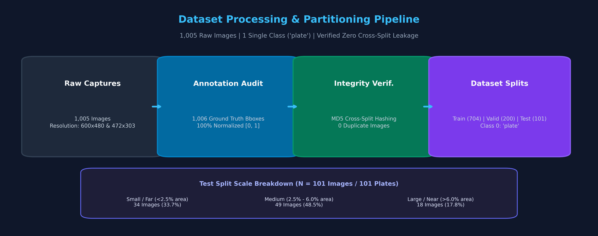
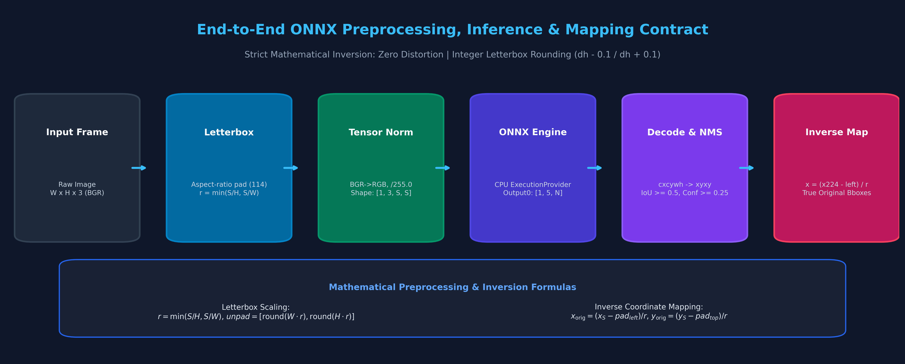
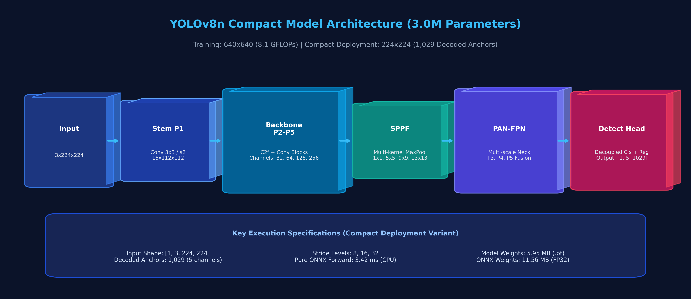
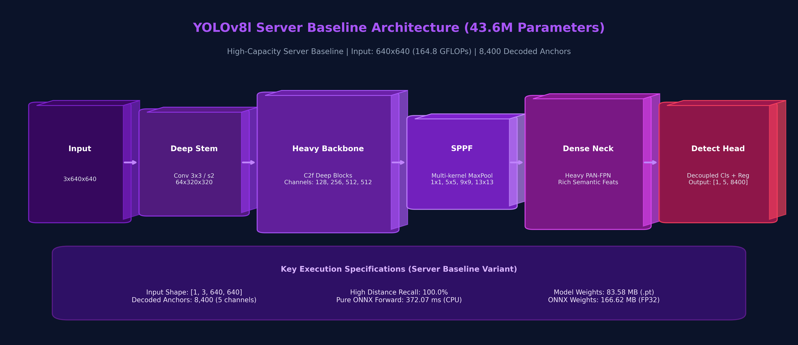
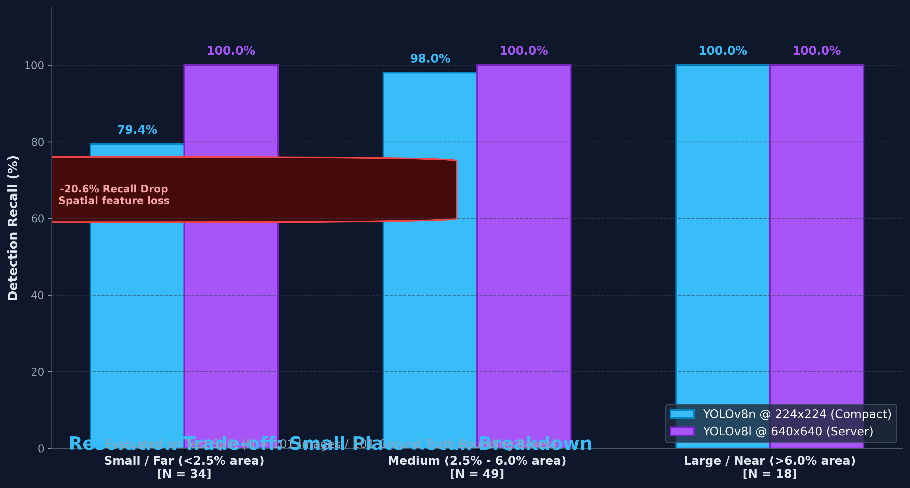
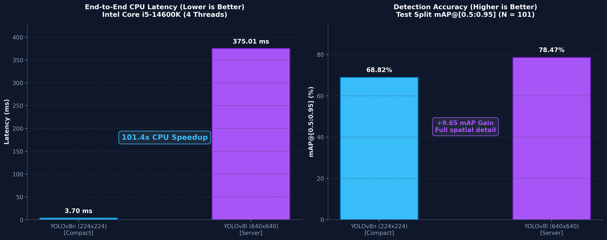

# Vietnamese License Plate Detection: Controlled Benchmark & Deployment Pipeline

[](https://www.python.org/)
[](https://pytorch.org/)
[](https://docs.ultralytics.com/)
[](https://onnxruntime.ai/)
[](LICENSE)

A rigorous, reproducible benchmark and deployment pipeline comparing a high-throughput compact detector (**YOLOv8n**, 3.0M params) and a high-capacity server detector (**YOLOv8l**, 43.6M params) for Vietnamese vehicle license plate detection.

---

## Table of Contents
- [1. Project Overview](#1-project-overview)
- [2. Model Variants](#2-model-variants)
- [3. End-to-End Model Pipeline](#3-end-to-end-model-pipeline)
- [4. Architecture Documentation](#4-architecture-documentation)
- [5. Training Protocols](#5-training-protocols)
- [6. Official Ultralytics Evaluation](#6-official-ultralytics-evaluation)
- [7. Deployment-Resolution Evaluation](#7-deployment-resolution-evaluation)
- [8. Standardized CPU Benchmark](#8-standardized-cpu-benchmark)
- [9. Reproducible Inference](#9-reproducible-inference)
- [10. Packaging & Artifact Integrity](#10-packaging--artifact-integrity)
- [11. Two-Stage ALPR & Character Recognition (OCR) Integration](#11-two-stage-alpr--character-recognition-ocr-integration)
- [12. Limitations & Scope](#12-limitations--scope)
- [13. Repository Structure](#13-repository-structure)

---

## 1. Project Overview

This project implements a controlled object detection benchmark focused on Vietnamese vehicle license plates under real-world vehicle capture conditions:

- **Task**: Single-class bounding box detection (`0: 'plate'`).
- **Dataset Scale**: 1,005 authentic captures partitioned into:
  - **Train**: 704 images (705 ground truth bounding boxes).
  - **Valid**: 200 images (200 ground truth bounding boxes).
  - **Test**: 101 images (101 ground truth bounding boxes).
- **Data Integrity Audit**:
  - Full coordinate audit confirmed zero invalid or out-of-range labels ($0.0 \le cx, cy, w, h \le 1.0$).
  - Full MD5 cryptographic hashing verified **zero duplicate leakage across train, validation, and test splits**.



---

## 2. Model Variants

Two architectural configurations were benchmarked to quantify the performance-computation envelope:

1. **YOLOv8n (Compact Inference Variant)**:
   - **Parameters**: 3,005,843 (3.0M)
   - **Computation**: 8.1 GFLOPs at $640 \times 640$
   - **Evaluation Resolutions**:
     - *Training / Full-Resolution Baseline*: $640 \times 640$ (8,400 anchors)
     - *Compact Deployment Evaluation*: $224 \times 224$ (1,029 anchors)
   - *Design Goal*: Low-latency CPU inference. *(Note: Not designated as edge-optimized as physical ARM/mobile board measurements have not been conducted).*

2. **YOLOv8l Stage 2 (Server Fine-Tuned Baseline)**:
   - **Parameters**: 43,607,379 (43.6M)
   - **Computation**: 164.8 GFLOPs at $640 \times 640$
   - **Evaluation Resolution**: $640 \times 640$ (8,400 anchors)
   - *Design Goal*: Maximal spatial feature preservation and distance recall across unconstrained scales.

---

## 3. End-to-End Model Pipeline

The pipeline enforces a strict mathematical transformation contract between training, export, and inference:

```
Dataset Images
    │
    ▼
YOLO Annotations [class, cx, cy, w, h]
    │
    ▼
Partitioned Splits (Train: 704 | Valid: 200 | Test: 101)
    │
    ▼
Ultralytics Training (SGD / AdamW with Cosine Decay)
    │
    ▼
Checkpoint Selection (best.pt by validation mAP@[0.5:0.95])
    │
    ▼
ONNX Export (opset 17, dynamic=False, simplify=True)
    │
    ▼
Letterbox Preprocessing (dh - 0.1 / dh + 0.1 integer rounding, pad=114)
    │
    ▼
Tensor Normalization (BGR -> RGB, Float32 / 255.0, shape: [1, 3, S, S])
    │
    ▼
ONNX Runtime Forward Pass (CPUExecutionProvider)
    │
    ▼
Raw Output Tensor Decode ([1, 5, N] -> [cx, cy, w, h, conf])
    │
    ▼
Confidence Thresholding (conf >= 0.25 / 0.50)
    │
    ▼
Non-Maximum Suppression (Greedy NMS, IoU >= 0.50)
    │
    ▼
Inverse Letterbox Coordinate Mapping (x_orig = (x_S - pad_left) / scale_ratio)
    │
    ▼
Final Bounding Boxes in Original Pixel Coordinate Space
```



---

## 4. Architecture Documentation

Detailed volumetric tensor blocks for both model variants:

### 4.1. YOLOv8n Compact Model


### 4.2. YOLOv8l Server Model


---

## 5. Training Protocols

Training was conducted under controlled, reproducible recipes logged in `runs/train/`:

| Hyperparameter / Protocol | Compact Model (`vn_plate_nano`) | Server Stage 1 (`freeze`) | Server Stage 2 (`finetune`) |
| :--- | :--- | :--- | :--- |
| **Model Architecture** | **YOLOv8n** | **YOLOv8l** | **YOLOv8l** (from Stage 1 best) |
| **Parameters** | 3.0M | 43.6M | 43.6M |
| **Input Resolution** | $640 \times 640$ | $640 \times 640$ | $640 \times 640$ |
| **Backbone Strategy** | Full network train | Frozen backbone (first 10 layers) | Full unfreeze, low-rate fine-tuning |
| **Optimizer** | SGD (`momentum=0.937`) | SGD (`momentum=0.937`) | AdamW (`weight_decay=0.0005`) |
| **Initial Learning Rate (`lr0`)** | $0.01$ | $0.001$ | $0.0001$ |
| **Final Learning Rate (`lrf`)** | $0.01$ | $0.1$ | $0.01$ |
| **Batch Size** | 32 | 16 | 16 |
| **Epochs Trained** | 56 (early stopped, best @ 36) | 20 (best @ 5) | 76 (early stopped, best @ 26) |
| **Criterion for Best Checkpoint** | Validation mAP@[0.5:0.95] | Validation mAP@[0.5:0.95] | Validation mAP@[0.5:0.95] |

---

## 6. Official Ultralytics Evaluation

Evaluated via the official `model.val()` runner using native PyTorch checkpoints on GPU (`NVIDIA GeForce RTX 5060 Ti`):

| Model Checkpoint | Dataset Split | Resolution | Precision | Recall | mAP@0.5 | mAP@[0.5:0.95] |
| :--- | :---: | :---: | :---: | :---: | :---: | :---: |
| **YOLOv8n** (`best.pt`) | Valid ($N=200$) | $640 \times 640$ | 99.9% | 100.0% | **99.50%** | **77.14%** |
| **YOLOv8n** (`best.pt`) | Test ($N=101$) | $640 \times 640$ | 99.9% | 100.0% | **99.50%** | **78.19%** |
| **YOLOv8l Stage 2** (`best.pt`) | Valid ($N=200$) | $640 \times 640$ | 99.4% | 100.0% | **99.50%** | **77.58%** |
| **YOLOv8l Stage 2** (`best.pt`) | Test ($N=101$) | $640 \times 640$ | 99.8% | 100.0% | **99.50%** | **78.47%** |

> **Context Disclosure**: The independent test set contains 101 images and 101 ground truth bounding boxes. While both architectures exhibit convergence ($>99.5\%$ mAP@0.5 and $\sim 78\%$ mAP@[0.5:0.95]), these results characterize performance on this benchmark distribution and must not be conflated with open-world, unconstrained deployment accuracy.

---

## 7. Deployment-Resolution Evaluation

YOLOv8n was trained at $640 \times 640$ but evaluated at $224 \times 224$ to quantify the impact of downsampling on spatial feature representation:

| Evaluation Mode | Input Resolution | Precision | Recall | mAP@0.5 | mAP@[0.5:0.95] | Impact |
| :--- | :---: | :---: | :---: | :---: | :---: | :--- |
| **Full Resolution** | $640 \times 640$ | 99.9% | 100.0% | **99.50%** | **78.19%** | Training baseline |
| **Compact Resolution** | $224 \times 224$ | 99.2% | 96.0% | **99.25%** | **68.82%** | $-9.37$ points mAP@[0.5:0.95] drop |

### Distance / Scale Slice Breakdown (Test Set, $N = 101$)
Plate area was categorized relative to total image area (IoU threshold $0.5$):

- **Small / Far Plates** ($< 2.5\%$ area, $N = 34$):
  - Compact ($224 \times 224$): **79.4% recall** (27/34 detected).
  - Server ($640 \times 640$): **100.0% recall** (34/34 detected).
- **Medium Plates** ($2.5\% - 6.0\%$ area, $N = 49$):
  - Compact ($224 \times 224$): **98.0% recall** (48/49 detected).
  - Server ($640 \times 640$): **100.0% recall** (49/49 detected).
- **Large / Near Plates** ($> 6.0\%$ area, $N = 18$):
  - Compact ($224 \times 224$): **100.0% recall** (18/18 detected).
  - Server ($640 \times 640$): **100.0% recall** (18/18 detected).



*Downsampling to $224 \times 224$ preserves high recall on medium and near plates ($98.0\%$ and $100.0\%$), but incurs a $20.6\%$ miss rate on distant plates where pixel dimensions drop below the backbone's feature extraction threshold.*

---

## 8. Standardized CPU Benchmark

Latency was profiled under an explicit, controlled measurement protocol:
- **CPU**: Intel Core i5-14600K (14 physical cores, 20 logical threads).
- **Runtime**: ONNX Runtime (`CPUExecutionProvider`, 4 intra-op threads, graph optimization `ORT_ENABLE_ALL`).
- **Protocol**: 10 warmup runs, averaged across 50 iterations (Nano) and 30 iterations (Large).

| Model Variant | Resolution | Preprocessing | Pure ONNX Forward | Postprocessing (NMS) | End-to-End Latency | Throughput |
| :--- | :---: | :---: | :---: | :---: | :---: | :---: |
| **YOLOv8n (Compact)** | $224 \times 224$ | 0.19 ms | **3.42 ms** | 0.09 ms | **3.70 ms** | **270.3 FPS** |
| **YOLOv8l (Server)** | $640 \times 640$ | 2.78 ms | **372.07 ms** | 0.16 ms | **375.01 ms** | **2.7 FPS** |



> **Measurement Scope**: This benchmark reflects CPU workstation execution with 4 threads and does not represent inference on embedded ARM platforms or mobile NPU accelerators.

---

## 9. Reproducible Inference

A standalone inference script [`scripts/infer.py`](scripts/infer.py) is provided to execute inference independently from PyTorch or ONNX graphs.

### Preprocessing & Tensor Contract
- **Input `images`**: `[1, 3, S, S]` (Float32, RGB order, normalized to $[0.0, 1.0]$).
- **Output `output0`**: `[1, 5, N]` (Float32):
  - Values: `[cx, cy, w, h, conf]`. Coordinates are decoded absolute pixels in $S \times S$ space.
  - Confidence passes through `Sigmoid` ($conf \in [0, 1]$).
  - `end2end: False` (Client-side NMS and inverse letterbox mapping required).

### CLI Usage Examples

```bash
# 1. Run compact ONNX model (224x224)
python scripts/infer.py \
    --weights vn-plate-app/app/src/main/assets/best.onnx \
    --source "datasets/Vietnam license-plate.v1i.yolo26/test/images/CarLongPlate115_jpg.rf.122cb025d8830754c49e2956145c18a3.jpg" \
    --imgsz 224 \
    --conf 0.5 \
    --output output_edge.jpg

# 2. Run server ONNX model (640x640)
python scripts/infer.py \
    --weights "vn-plate-20260805T073942Z-1-001/vn-plate/runs/train/vn_plate_stage2_finetune/weights/best.onnx" \
    --source "datasets/Vietnam license-plate.v1i.yolo26/test/images/CarLongPlate115_jpg.rf.122cb025d8830754c49e2956145c18a3.jpg" \
    --imgsz 640 \
    --conf 0.5 \
    --output output_server.jpg

# 3. Run directly from PyTorch checkpoint (.pt)
python scripts/infer.py \
    --weights "vn-plate-20260805T073942Z-1-001/vn-plate/runs/train/vn_plate_nano/weights/best.pt" \
    --source "datasets/Vietnam license-plate.v1i.yolo26/test/images/CarLongPlate115_jpg.rf.122cb025d8830754c49e2956145c18a3.jpg" \
    --imgsz 640
```

---

## 10. Packaging & Artifact Integrity

All model checkpoints are cryptographically hashed and tracked in [`weights_manifest.json`](weights_manifest.json):

| Identifier | Checkpoint File | Size | SHA-256 Checksum |
| :--- | :--- | :---: | :--- |
| `yolov8n_edge_onnx` | `vn-plate-app/app/src/main/assets/best.onnx` | 11.56 MB | `28c4c12958f705ae658c6901f2e9e755a7e03f629a73c23750c7d37761af31dd` |
| `yolov8n_edge_pt` | `.../vn_plate_nano/weights/best.pt` | 5.95 MB | `873851543beeb9c6483c07e64b99400d1554a70244862b1cd70b62035b6431c2` |
| `yolov8l_server_onnx` | `.../vn_plate_stage2_finetune/weights/best.onnx` | 166.62 MB | `21f2e3aefc46dadd0b4b7e4a0200d0443644c41e982f9d756ef17231b74eaaa3` |
| `yolov8l_server_pt` | `.../vn_plate_stage2_finetune/weights/best.pt` | 83.58 MB | `8674e24abccf02522f12c34d6829efc3c0e13ab0c53a3ea4850bd6fe5a0671fd` |

*Git Hygiene: Raw datasets, large zip backups, and intermediate training caches are excluded from version control via `.gitignore`.*

---

## 11. Two-Stage ALPR & Character Recognition (OCR) Integration

While this benchmark focuses on the core localization engine (YOLOv8 Plate Detector), the system is designed to integrate into a **Two-Stage Automatic License Plate Recognition (ALPR)** pipeline:

```
Camera Frame
    │
    ▼
[Stage 1: Plate Localization] ────────► Custom YOLOv8n / YOLOv8l (ONNX Runtime)
    │                                    Output: [x1, y1, x2, y2, confidence]
    ▼
Coordinate Unscaling & Dynamic Crop
    │
    ▼
Aspect-Ratio & Padding Expansion (+8% Width, +12% Height to preserve edge characters)
    │
    ▼
[Stage 2: Character Recognition] ──────► Asynchronous OCR Worker
                                         Engine: On-Device Text Recognizer (e.g., Google ML Kit)
                                         Regex Postprocessing: Two-line Vietnamese Plate Format
                                         Format 1: "[Province/City Letters]-[Serial Number]" (e.g., "30A-123.45")
                                         Format 2: Single-line long plate format
```

### Decoupled Asynchronous OCR Worker Architecture
In streaming applications (e.g., parking gate access control), executing text recognition synchronously within the detector loop introduces severe frame jitter because character segmentation and text recognition take 20–50 ms.

To solve this, the application implements a **decoupled single-slot OCR worker**:
- **Non-blocking frame dispatch**: The detector thread drops frames into an `AtomicReference` single-slot queue without waiting for OCR.
- **Frame-ID versioning**: Each request carries an incrementing `frameId`. The OCR worker processes only the freshest frame, dropping intermediate stale frames when the queue is occupied.
- **State cache**: Latest recognized plate text is attached to live detection overlays without stalling the real-time inference loop.

---

## 12. Limitations & Scope

To ensure engineering rigor, the following boundaries of this study are stated:
1. **Test Set Scope**: The test split contains 101 images / 101 bounding boxes under standard lighting conditions; metrics do not generalize to severe occlusions, extreme weather, or acute camera angles.
2. **Hardware Environment**: Profiling was conducted on an x86 workstation CPU; inference speeds will vary significantly on embedded ARM boards (Raspberry Pi, Jetson) or mobile devices.
3. **Resolution Sensitivity**: The compact variant at $224 \times 224$ exhibits a $20.6\%$ miss rate on small distant plates. Full $640 \times 640$ resolution is recommended where camera-to-vehicle distances exceed standard parking gate ranges.
4. **Task Boundary & Evaluation Metrics**: The quantitative benchmark evaluates vehicle license plate localization and bounding box regression (mAP, IoU, Precision, Recall). Character recognition (OCR) is integrated downstream via a decoupled execution worker, but alphanumeric error metrics (CER/WER) were not evaluated quantitatively due to the lack of character-level ground truth strings in the underlying dataset.

---

## 13. Repository Structure

```
titsmat-parking/
├── datasets/                             # Audited dataset splits (train / valid / test)
├── docs/
│   └── figures/                          # Publication-grade technical figures
│       ├── 1_dataset_pipeline.png
│       ├── 2_yolov8n_architecture.png
│       ├── 3_yolov8l_architecture.png
│       ├── 4_inference_pipeline.png
│       ├── 5_resolution_tradeoff.png
│       └── 6_model_comparison.png
├── scripts/
│   ├── generate_fixtures.py              # Test fixture generator for runtime parity
│   ├── infer.py                          # Standalone Python inference script (.pt & .onnx)
│   └── visualize_architecture.py         # Technical architecture diagram generator
├── tests/
│   └── fixtures/                         # Preprocessed tensors, metadata & verification cases
├── vn-plate-app/                         # Android application source (uses bundled ONNX)
├── train_license_plate.py                # Two-stage YOLOv8 training script
├── weights_manifest.json                 # Cryptographic SHA-256 manifest
└── README.md                             # Technical benchmark documentation
```
