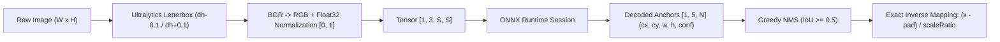

# Vietnamese License Plate Detection: Controlled Benchmark & Deployment Pipeline

A reproducible detection benchmark and deployment pipeline comparing a high-throughput compact variant (**YOLOv8n**, 3.0M params) and a high-capacity server detector (**YOLOv8l**, 43.6M params) on Vietnamese vehicle license plates.

---

## 1. Dataset & Split Audit

- **Dataset Source**: Vietnamese License Plate dataset (1-class detection: `plate`).
- **Class Mapping**: `0: 'plate'`.
- **Dataset Partitioning & Scope**:
  - **Train**: 704 images, 705 ground truth bounding boxes.
  - **Valid**: 200 images, 200 ground truth bounding boxes.
  - **Test**: 101 images, 101 ground truth bounding boxes.
- **Audit Findings**:
  - **Annotation Quality**: 100% valid bounding boxes with normalized coordinates $(cx, cy, w, h) \in [0, 1]$.
  - **Leakage Protection**: MD5 file hashing across splits confirmed **zero cross-split duplicate leakage**.
  - **Scale / Distance Distribution (Test Set, $N = 101$)**:
    - *Small / Far plates* ($< 2.5\%$ image area): $33.7\%$ ($N = 34$).
    - *Medium plates* ($2.5\% - 6.0\%$ image area): $48.5\%$ ($N = 49$).
    - *Large / Near plates* ($> 6.0\%$ image area): $17.8\%$ ($N = 18$).

---

## 2. Model Training Configurations

| Parameter | Compact Variant (`vn_plate_nano`) | Server Baseline Stage 1 (`freeze`) | Server Baseline Stage 2 (`finetune`) |
| :--- | :--- | :--- | :--- |
| **Architecture** | **YOLOv8n** (3.0M parameters, 8.1 GFLOPs) | **YOLOv8l** (43.6M parameters, 164.8 GFLOPs) | **YOLOv8l** (43.6M parameters, 164.8 GFLOPs) |
| **Training Resolution** | $640 \times 640$ | $640 \times 640$ | $640 \times 640$ |
| **Strategy** | Full network training | 10-layer backbone freeze | Full unfreeze, low learning-rate fine-tuning |
| **Optimizer** | SGD (`lr0=0.01, momentum=0.937`) | SGD (`lr0=0.001, momentum=0.937`) | AdamW (`lr0=0.0001, weight_decay=0.0005`) |
| **Epochs** | 56 (early stopped, best @ 36) | 20 (best @ 5) | 76 (early stopped, best @ 26) |
| **Batch Size** | 32 | 16 | 16 |

---

## 3. Evaluation & Controlled Benchmarks

Evaluation is partitioned into three distinct tiers to distinguish training convergence from deployment resolution and CPU profiling.

### 3.1. Official Ultralytics Validation (`model.val()`)
Evaluated via official Ultralytics runner on GPU (`RTX 5060 Ti`):

| Model Checkpoint | Split | Eval Resolution | Precision | Recall | mAP@0.5 | mAP@[0.5:0.95] |
| :--- | :---: | :---: | :---: | :---: | :---: | :---: |
| **YOLOv8n** (`best.pt`) | Valid ($N=200$) | $640 \times 640$ | 99.9% | 100.0% | **99.50%** | **77.14%** |
| **YOLOv8n** (`best.pt`) | Test ($N=101$) | $640 \times 640$ | 99.9% | 100.0% | **99.50%** | **78.19%** |
| **YOLOv8l Stage 2** (`best.pt`) | Valid ($N=200$) | $640 \times 640$ | 99.4% | 100.0% | **99.50%** | **77.58%** |
| **YOLOv8l Stage 2** (`best.pt`) | Test ($N=101$) | $640 \times 640$ | 99.8% | 100.0% | **99.50%** | **78.47%** |

*(Note: Test set comprises 101 images / 101 plates; high aggregate mAP reflects clean framing in the dataset rather than open-world unconstrained deployment).*

---

### 3.2. Deployment-Resolution Evaluation (Resolution Trade-off)
YOLOv8n was trained at $640 \times 640$ but exported to $224 \times 224$ for high-throughput inference. Evaluating at $224 \times 224$ quantifies the trade-off incurred by downsampling:

| Evaluation Mode | Input Resolution | Precision | Recall | mAP@0.5 | mAP@[0.5:0.95] | Evaluation Impact |
| :--- | :---: | :---: | :---: | :---: | :---: | :--- |
| **Training Resolution** | $640 \times 640$ | 99.9% | 100.0% | **99.50%** | **78.19%** | Full-resolution baseline |
| **Compact Deployment** | $224 \times 224$ | 99.2% | 96.0% | **99.25%** | **68.82%** | $-9.37$ points drop in mAP@[0.5:0.95] |

#### Plate Scale / Distance Breakdown on Test Set ($N = 101$, IoU $\ge 0.5$)
- **Small / Far Plates** ($< 2.5\%$ area, $N=34$):
  - Compact ($224 \times 224$): **79.4% recall** (27/34 detected).
  - Server ($640 \times 640$): **100.0% recall** (34/34 detected).
- **Medium Plates** ($2.5\% - 6.0\%$ area, $N=49$):
  - Compact ($224 \times 224$): **98.0% recall** (48/49 detected).
  - Server ($640 \times 640$): **100.0% recall** (49/49 detected).
- **Large / Near Plates** ($> 6.0\%$ area, $N=18$):
  - Compact ($224 \times 224$): **100.0% recall** (18/18 detected).
  - Server ($640 \times 640$): **100.0% recall** (18/18 detected).

> **Analysis**: Downsampling to $224 \times 224$ retains strong recall on medium and close-up plates ($>98\%$), but incurs a $20.6\%$ miss rate on distant plates because pixel dimensions fall below the detector's effective receptive field.

---

### 3.3. Standardized CPU Latency Profiling

- **Hardware**: Intel Core i5-14600K (14 cores / 20 threads).
- **Runtime**: ONNX Runtime (`CPUExecutionProvider`, 4 intra-op threads, `ORT_ENABLE_ALL` optimization).
- **Protocol**: 10 warmup runs, averaged across 50 iterations (Nano) and 30 iterations (Large).

| Model Variant | Input Size | Preprocessing | Pure ONNX Forward | Postprocessing (NMS) | End-to-End Latency | Throughput |
| :--- | :---: | :---: | :---: | :---: | :---: | :---: |
| **YOLOv8n (Compact)** | $224 \times 224$ | 0.19 ms | **3.42 ms** | 0.09 ms | **3.70 ms** | **270.3 FPS** |
| **YOLOv8l (Server)** | $640 \times 640$ | 2.78 ms | **372.07 ms** | 0.16 ms | **375.01 ms** | **2.7 FPS** |

*Under identical benchmarking conditions, the compact $224 \times 224$ pipeline achieves a **101.4× end-to-end CPU speedup** compared to the server $640 \times 640$ model.*

---

## 4. Preprocessing & Tensor Contract

To prevent aspect-ratio distortion and coordinate shifts during inference, both models follow a standardized contract:



- **Input Tensor**: `images [1, 3, S, S]` (Float32, normalized $[0.0, 1.0]$, RGB order).
  - Compact: $S = 224$.
  - Server: $S = 640$.
- **Output Tensor**: `output0 [1, 5, N]` (Float32):
  - Values: `[cx, cy, w, h, conf]`. Coordinates are decoded absolute pixels in $S \times S$ space.
  - Confidence has already passed through `Sigmoid` ($conf \in [0, 1]$).
  - `end2end: False` (NMS executed in client code).

---

## 5. Standalone Python Inference

Run standalone inference using [`scripts/infer.py`](scripts/infer.py) on `.onnx` or `.pt` weights:

```bash
# Run compact deployment model (224x224)
python scripts/infer.py \
    --weights vn-plate-app/app/src/main/assets/best.onnx \
    --source "datasets/Vietnam license-plate.v1i.yolo26/test/images/CarLongPlate115_jpg.rf.122cb025d8830754c49e2956145c18a3.jpg" \
    --imgsz 224 \
    --output output_edge.jpg

# Run high-capacity server model (640x640)
python scripts/infer.py \
    --weights "vn-plate-20260805T073942Z-1-001/vn-plate/runs/train/vn_plate_stage2_finetune/weights/best.onnx" \
    --source "datasets/Vietnam license-plate.v1i.yolo26/test/images/CarLongPlate115_jpg.rf.122cb025d8830754c49e2956145c18a3.jpg" \
    --imgsz 640 \
    --output output_server.jpg
```

---

## 6. Checksum Manifest

Cryptographic SHA-256 hashes recorded in [`weights_manifest.json`](weights_manifest.json):

- **`yolov8n_edge_onnx`** (11.56 MB): `28c4c12958f705ae658c6901f2e9e755a7e03f629a73c23750c7d37761af31dd`
- **`yolov8n_edge_pt`** (5.95 MB): `873851543beeb9c6483c07e64b99400d1554a70244862b1cd70b62035b6431c2`
- **`yolov8l_server_onnx`** (166.62 MB): `21f2e3aefc46dadd0b4b7e4a0200d0443644c41e982f9d756ef17231b74eaaa3`
- **`yolov8l_server_pt`** (83.58 MB): `8674e24abccf02522f12c34d6829efc3c0e13ab0c53a3ea4850bd6fe5a0671fd`
